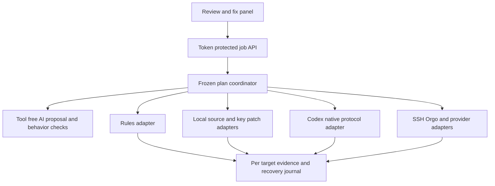
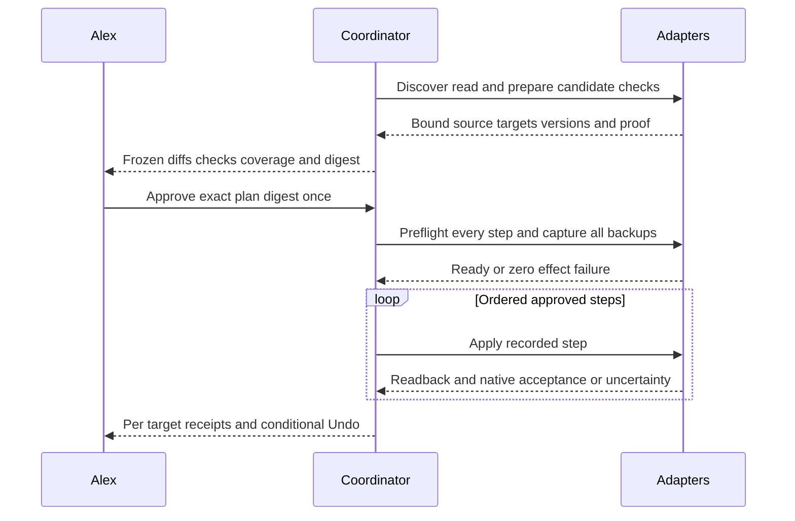
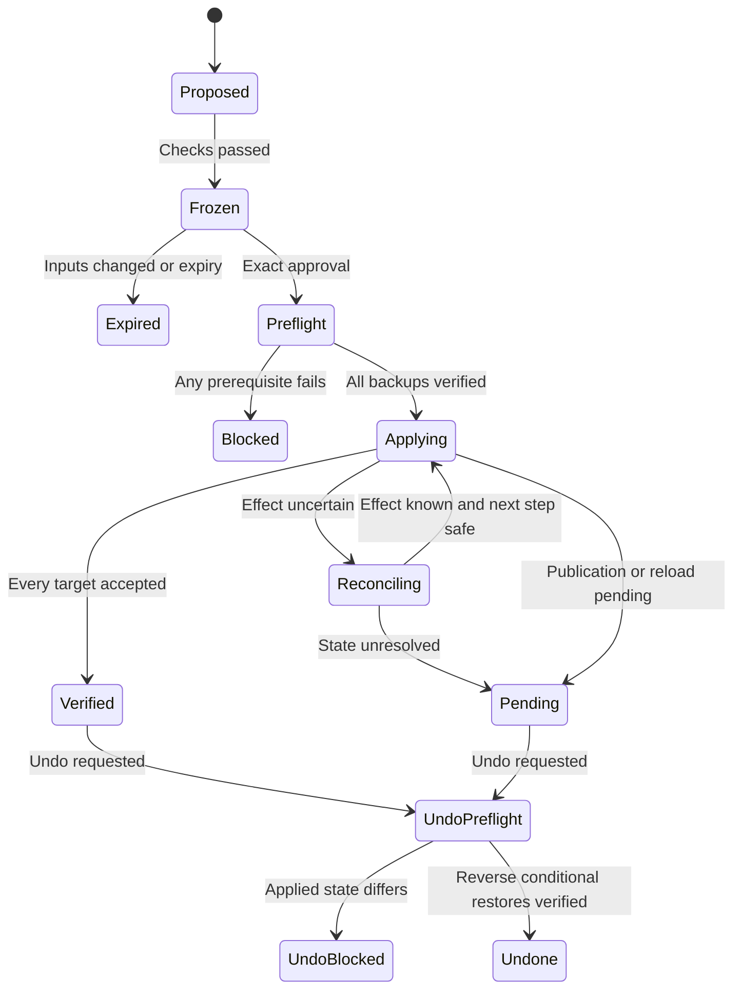
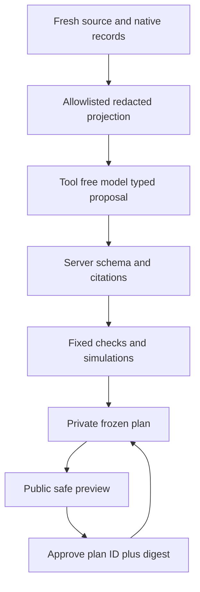
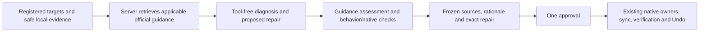

# Universal Review and Repair - Plan

## Goal Capsule

- **Objective:** Alex can review a tested repair for his own agent systems, approve it once, and see whether every affected destination received and accepted the change.
- **Means:** Extend Review & fix with a frozen repair coordinator and owner-specific adapters (KTD1–KTD6).
- **Authority:** The user-approved exact bundle governs application; existing account, production, spending, outside-message, security and deletion gates remain in force (R9).
- **Execution profile:** Fixture-first implementation, real read-only discovery and proposal evidence, desktop and narrow browser verification, independent review, then a pushed pull request and CI.
- **Stop conditions:** A changed baseline requires a new proposal; an uncertain mutation requires readback before further effects (R5–R7).
- **Finisher:** The primary integrates disjoint work, obtains independent review, records proof and ships the PR. Development acceptance never applies a repair to actual agent sources or production systems (R10).

---

## Product Contract

### Summary

Expand the existing Review & fix panel from instruction text to hooks, skills, app settings, CLI configuration and owned executables, plus Alex's remote systems.
AI researches applicable official guidance, diagnoses the source problem, proposes a concrete repair and tests its intended and preserved behavior before approval.
One approval applies the exact reviewed bundle through each source's owner, synchronizes its registered destinations, verifies each affected target and offers a conditional Undo.
The existing rule-repair contract in `docs/APPROVED_RULE_REPAIR.md` remains authoritative for its category.

### Problem Frame

The current flow repairs handwritten instructions while other causes of agent failures sit in settings, hooks, skill sources, CLI files and remote systems.
A map of those files does not save Alex from performing the repair and proving it reached the system that uses it.
A local success also cannot tell him whether a remote machine or app accepted the change.

### Key Decisions

- **One approval covers the tested bundle.** Governs R2, R3. (session-settled: user-directed — chosen over editing wording by hand: Alex wants AI to propose and test the actual repair.)
- **Each owner applies its settings.** Governs R4. (session-settled: user-directed — chosen over blind config replacement: the app remains the source of truth.)
- **Every affected destination needs its own proof.** Governs R6. (session-settled: user-directed — chosen over treating a local pass as remote proof: copies and runtimes can disagree.)

### Requirements

The 2026-10-21 source-grounding correction adds R12-R14; R1-R11 and the user-approved approval, ownership and verification decisions remain in force.

- R12. Before proposing a repair, retrieve current applicable official guidance through the existing Composio route and show its exact source, retrieval/crawl evidence, relevant product/version and any applicability gap.
- R13. Explain each proposed fix using the actual source diagnosis, documented practice, why it fits this target and a rejected alternative; distinguish vendor requirements, recommendations, Alex policy and inference.
- R14. Bind the guidance, citations, assessment and limitations into the tested bundle; unavailable or unsupported research cannot appear as a verified source-backed fix, and an existing approved job retains its recovery and Undo path.

**Coverage and proposal**

- R1. Review & fix supports rules, hooks, skills, app settings, CLI configs, owned executable sources and registered remote file/API targets; each supported category includes discovery, proposal, tests, apply, readback and conditional Undo.
- R2. AI creates citation-backed proposed changes and fix/preserve behavioral checks using the existing isolated subscribed model route; native checks supplement simulated choices without mislabeling simulation as live execution. A separately labeled clarification case may resolve a genuinely conflicting baseline: it cites at least two distinct current directives, observes an ambiguous before decision and a known expected candidate decision. Ordinary fix and preserve cases retain their known-answer requirements.
- R3. The UI displays the complete immutable bundle, exact public diffs, all affected targets, checks and limitations before one approval; browser input never supplies trusted checks, commands, accounts or new targets.

**Application and verification**

- R4. Writes use the source's native owner or a bounded owner-specific adapter, preserve unrelated data and credentials, and synchronize only registered dependent copies.
- R5. Before the first mutation, the coordinator validates every step and captures every required recoverable preimage; application remains bound to source, context, target, native-version, adapter and account/host identities in the approved digest.
- R6. Completion requires fresh per-target readback and the category's native acceptance check; written, byte-verified, effective, reloaded, publication-pending and unavailable remain distinct outcomes.
- R7. Apply stops on the first uncertain effect and reconciles by readback; retry resumes the recorded operation, and Undo restores in reverse order only where recorded applied state still matches.
- R8. Long operations survive HTTP interruption with private durable job state, bounded progress events and recovery; the existing loopback and mutation-token protection also covers job reads and actions.

**Authority and acceptance**

- R9. Existing gates and named accounts remain binding; no new provider, paid fallback, dependency, guard, hook, recurring job, service restart or arbitrary AI command execution enters this feature.
- R10. Development proves real adapter boundaries with disposable homes, files, Git remotes, SSH/API fixtures and native Codex fixtures; real systems permit read-only discovery/proposal, never actual Apply during acceptance.
- R11. The panel exposes local and remote targets with coverage and evidence age, and never presents an unsupported target or pending destination as repaired.

### Scope Boundaries

All R1 categories are active implementation scope, including adapters that need to be built.
An individual unregistered or inaccessible object may report its exact missing capability, but a category cannot be replaced by manual instructions or called complete without its automated lifecycle.

Considered and not built: a general shell agent, universal arbitrary API proxy, automatic retries of uncertain writes, new monitoring services, and broad provider installation.
Fixed adapters and recorded reconciliation meet this feature's need; an additional capability would need a concrete requested repair that existing owners cannot express.
Provider-managed plugin/system caches remain owned by their provider; their canonical source or native configuration action is selected instead of overwriting downloaded files.

### Acceptance Examples

- AE1. **Covers R1–R6.** A skill correction changes its canonical source, preserves discovery links, passes structural/lifecycle checks and reports fresh runtime discovery separately from source-byte verification.
- AE2. **Covers R3, R5.** A target or native config version changes after preview; Apply performs zero mutations and asks for a regenerated preview within the same flow.
- AE3. **Covers R6, R7.** A remote write times out after taking effect; readback establishes the exact resulting state, later targets remain untouched, and retry does not repeat the uncertain write.
- AE4. **Covers R4, R7.** Undo encounters a later unrelated key edit; key-scoped restoration preserves it, while a changed repaired key is refused without overwriting newer work.
- AE5. **Covers R8, R11.** The tab closes during synchronization; reopening shows the original job's evidence and truthful pending targets rather than starting another application.
- AE6. **Covers R1, R2, R4.** An owned receipt guard or handoff rule blocks harmless work while the canonical instructions say to fix and continue. The actual canonical source is registered, the model receives the current gates as read-only context, and the proposal narrows the excess restriction while preserving spending, contact, production, deletion, security and authentic-approval boundaries. A provider-managed cache is never substituted for an owned plugin's source and native refresh.

---

## Planning Contract

### Existing Evidence and Assumptions

`tools/local_file_repairs.py` already freezes previews, binds context hashes, backs up source bytes, uses atomic file replacement and scoped Git publication, and reconciles partial phases.
`tools/local_file_distribution.py` freezes native instruction projections and validates copy baselines.
`tools/local_file_checks.py` runs simulated before/candidate choices; it does not establish runtime loading or executable safety.
`tools/local_files.py` indexes bounded local roots and includes provenance; its current inventory is not remote or effective-state evidence.
The API and server bridge currently run repair work synchronously, while `app/src/app/api/workflow/events/[jobId]/route.ts` and `app/src/app/api/workflow/recover/[jobId]/route.ts` provide job-ID interaction patterns.

Assumptions: registered source ownership and target definitions are server-owned data; supported native actions are explicit adapter capabilities rather than inferred from file extension.
The implementation resolves exact object selectors during read-only discovery and records the result before proposal.
A missing connection or version-specific method is a target blocker to repair, not permission to silently substitute a writer.
No CE configuration or Compound Pack sources apply; the artifact root is `docs`.
Fresh 2026-10-21 read-only evidence proves SSH identity for `agency-mini`, Paperclip agent/configuration/revision GETs, Hindsight Composio bank GET and the documented config-helper GET.
Exact card-listed Orgo, Neon and SigNoz custom-tool schema lookups returned `ToolNotFound`; that proves schema lookup failure, not failed actual execution or a disconnected account. Primary correct-account actual Neon project-list and SigNoz service-list reads subsequently succeeded. An actual Orgo read reached vendor validation and rejected the argument shape, establishing transport reachability but not a successful computer read.
Resolve exact native payload contracts on those same registered routes in U3. Metadata lookup failure is not a category exclusion or permission to switch accounts/routes.
No actual remote/provider write was tested in research.

### Key Technical Decisions

- KTD1. **Add a coordinator rather than widen the rule writer.** A new universal envelope delegates the existing rule category to its current service, preserving `docs/APPROVED_RULE_REPAIR.md`; source-family adapters own other semantics. Governs R1, R4.
- KTD2. **Freeze adapter operations rather than AI commands.** The model returns typed proposals over redacted source projections; fixed server code resolves operations, tests and destinations. The digest includes exact operations and checks, so changing a draft invalidates approval. Governs R2, R3, R9. (session-settled: user-directed — chosen over editing wording by hand: the approval must refer to the AI-tested repair.)
- KTD3. **Use native configuration APIs where they exist.** Codex uses `config/read` and `config/batchWrite` with explicit `filePath`, `expectedVersion`, key paths, merge strategy and `reloadUserConfig`; inspect `okOverridden` and effective readback. Other JSON configuration owners use narrow key patches over freshly parsed state, preserving secret and unknown fields. Governs R4, R6. (session-settled: user-directed — chosen over blind config replacement: writes must respect the owning application.)
- KTD4. **One ordered transaction spans adapters, without pretending it is atomic.** Validate and back up all steps before mutation, record intent before each effect, persist observed results afterward, and stop at uncertainty. Source distribution and source publication are explicit steps with independent outcomes. For several approved files in one Git repository, publish one commit containing exactly the approved path set after all local writes and readbacks; do not iterate legacy single-path commits against stale HEAD. Project all candidate canonical instruction changes together and freeze the union of dependent outputs once, so separate projections cannot overwrite one another. Governs R5–R8.
- KTD5. **Remote files use a fixed JSON-stdin runner.** SSH uses the registered `agency-mini` alias; Orgo uses the existing named Composio login and exact fixed host IDs. The reviewed runner receives typed relative selectors and bytes, rejects escapes/links, and implements read, preflight, backup, anchored final comparison, atomic replacement, native check and conditional inverse; the comparison/replacement window remains explicit. No model-generated shell reaches the transport. Governs R1, R4, R9.
- KTD6. **Provider configuration uses typed native operations through the current route.** Registered adapters bind account, object, tool/schema revision and exact fields; Composio `execute --dry-run` validates the provider payload and account without writing, followed after approval by write and native readback. Paperclip uses its card's existing mini-local SSH/REST exception with the token remaining on the mini. Hindsight bank config uses the existing card-documented admin REST helper and its scoped key acquisition; the Composio shared-memory route remains separate and no new config writer or key is invented. Conditional inverse requires captured fields and a current-state match. Governs R1, R4–R7, R9.
- KTD7. **Target evidence is a first-class receipt.** A local file hash cannot advance a remote target or runtime to verified; each adapter emits fresh target identity, readback fingerprint, native check and reload limitation. Governs R6, R11. (session-settled: user-directed — chosen over local-pass-as-remote-proof: Alex needs evidence from every affected destination.)
- KTD8. **Keep durable job state private and reuse existing authentication.** Opaque plan/job IDs and a digest are the only browser mutation inputs; the server resolves targets and native actions. Job status never exposes preimages, credentials or raw provider errors. Governs R3, R8.

The chosen mechanisms extend current owner and transaction patterns; no competing mechanism needs a bake-off because the user settled approval, ownership and verification, and current native contracts determine the remaining transport boundaries.

### Shared Adapter and Wire Contract

The U1 owner freezes this contract before parallel implementation.
Python adapters expose discover, read, propose/normalize, preflight, backup, apply, verify, reconcile and undo phases through a typed registry.
Adapters return structured data only; they never receive executable model text.
The bridge serializes the same versioned fields in Python and TypeScript.

| Object | Required fields and meaning |
|---|---|
| Target | Opaque ID, category, canonical owner, local/remote scope, stable identity tuple, route/login/host/object selector, capability set, observed time, evidence reference, missing capability |
| Plan | Schema version, plan ID, expiry, intent, safe source/context projections and fingerprints, ordered operations, adapter/check versions, copy dependencies, per-target before/after fingerprints, recovery requirements, plan digest |
| Operation | Stable step ID, adapter/action enum, registered target ID, allowed key/path selector, exact candidate or secret-safe field patch, expected source/native version, checks, inverse descriptor |
| Check | Kind `simulated_behavior`, `syntax`, `owner_lifecycle`, `native_dry_run`, `readback` or `runtime`; passed/failed/unavailable, fixed runner ID, input/output digests, evidence, timestamp, limitations |
| Job | Job ID, plan digest, approval receipt, ordered per-step phase/outcome, next step, unknown-effect marker, reconciliation evidence, per-target result, publication state, private backup references |
| Public result | Source and targets with written/byte-verified/effective/reloaded/pending/blocked/unknown distinctions, safe evidence links and specific remaining work; no raw backup or secret values |

Plan hashes include adapter identity/version, transport/tool schema, account and host binding, exact patch and all check results.
Sensitive JSON fields are absent from model input and public diffs, not replaced with a value that could accidentally be written.
Private inverse data captures only changed nonsecret key values for JSON configuration; no full plaintext secret-bearing configuration is copied. Whole sensitive config copies never enter model context, repo files, browser output or logs.
The existing approved Drive-backed location owns durable file preimages, and every backup must be read back before mutation.

### Category Capability Matrix

| Category | Proposal and owner | Required checks and destination proof | Application and Undo |
|---|---|---|---|
| Rules | Existing canonical rule sources and native instruction builder | Existing simulated cases, native byte budget, source and every generated/import output readback | Delegate existing service; preserve scoped Git publication and copy recovery |
| Skills | Canonical shared skill folder and lifecycle owner; provider-owned cache routes to provider | Structural docs validation, route/reference/link checks, fresh native skill discovery; distinguish discovery from selection | Patch canonical content, preserve link state, sync registered surfaces, restore conditional preimages |
| Hooks | Parsed owner configuration plus registered executable source | Owner schema, command-path existence, syntax, fixture behavior and trust/enabled readback; no untrusted hook execution before approval | Narrow owner key/file patch and owned script edit; conditional key/file inverse |
| App settings | Native app API or documented owner key patch; Codex native protocol | Provider schema/dry-run, effective value, version/override/reload readback | Native versioned write/inverse; no direct Codex TOML overwrite |
| CLI configs | Registered CLI owner with allowed key paths | Native parser/config check and effective safe projection | Key-scoped patch/inverse preserving unrelated keys and secrets |
| Owned executables | Canonical script source with fixed language runner | Python compile/AST, shell syntax, Node syntax as appropriate, plus isolated fixture behavior | Atomic byte/mode CAS write and conditional restore; never execute untrusted candidate against real systems before approval |
| Remote files | Fixed SSH/Orgo runner over registered roots and host identity | Same category checks on target, target-side hash/mode and native readback | Target preimage, atomic CAS, target-side conditional inverse |
| Remote provider config | Existing Composio/Paperclip owner route and exact object fields | Native schema/dry-run and fresh object/effective readback | Exact field patch and conditional inverse using current object state |

Hook and CLI format support is built as registered owner definitions, not a blanket file writer.
For Claude/Cursor hooks, fixture tests exercise documented JSON ownership and fresh configuration/trust readback; if a vendor lacks reload evidence, the result states new-session pending instead of inventing runtime success.
Codex `skills/config/write` only toggles named skill enablement and has no native version field; it is separate from canonical skill-text repair and requires an immediate before-state check and fresh `skills/list` readback.

### High-Level Technical Design

Component relationships:

Approval and effect protocol:

Persistent lifecycle:

Model data and API surface:

### Threats and Failure Decisions

| Threat or failure | Required behavior |
|---|---|
| Secret exposure or placeholder overwrite | Parse and project allowed fields; preserve unknown/secret values locally; screen model, preview, journal and exception outputs |
| Tampered browser plan or check | Resolve opaque IDs server-side; verify stored digest and trusted check provenance |
| Stale file/context or native version | Preflight all operations and reject before effects; repeat CAS immediately at each write |
| Untrusted hook/script candidate | Fixed syntax and disposable fixture checks before approval; no real hook invocation as a test |
| Account, host or object confusion | Bind identity tuple and named login in plan and transport; verify fresh identity before write |
| Unknown remote/provider write | Stop, read back through owner, record partial result; never auto-repeat the write |
| Concurrent change during Undo | Compare repaired fields/files with applied receipt and refuse conflicting restoration |
| False synchronized claim | Require target-specific fresh receipts; pending reload or publication stays pending |
| Native override or nonreloadable setting | Read effective value and override metadata; report owner/new-session requirement |
| Partial backup or preflight failure | Zero mutations; retain safe diagnostic and invalidate readiness |

### Sequencing and Ownership

U1 lands the shared contract first.
U3 verifies exact native payload/account bindings on the existing registered routes; successful actual reads already establish Neon and SigNoz reachability.
The generic remote SSH and provider fixtures can proceed meanwhile; final remote coverage cannot pass on stale card metadata. A schema lookup failure does not itself disable real execution; use a fresh allowed read to establish reachability.
U2, U3, U4 and U5 can then run in parallel with disjoint file ownership; at most five builders, no helper edits to another owner's files.
The primary performs final wiring where ownership must cross, integration checks, documentation reconciliation and independent review.
Any needed shared-contract change returns to U1's owner before dependent work continues.

---

## Implementation Units

### U1. Frozen coordinator, registry and durable jobs

- **Goal:** Build the common transaction and target contract used by every category.
- **Requirements:** R1, R3, R5–R9; AE2–AE5; KTD1, KTD4, KTD8.
- **Dependencies:** None; publish the shared contract before other units change their modules.
- **Files:** New `tools/universal_repairs.py`, `tools/repair_contracts.py`, `tools/repair_registry.py`, `tools/test_universal_repairs.py`, `app/src/lib/types/repairs.ts`, `app/src/lib/server/universal-repairs.ts`, `app/src/app/api/repairs/route.ts`, `app/src/app/api/repairs/jobs/[jobId]/route.ts`.
- **Approach:** Implement the envelope, fixed adapter dispatch, job journal, all-step preflight/backup barrier, exact approval, reconciliation and reverse Undo from KTD4. Expose opaque IDs and safe progress through KTD8. Delegate the existing rule service without expanding its allowlist.
- **Patterns to follow:** Existing private writes, phase receipts and CAS in `tools/local_file_repairs.py`; workflow event/recovery route patterns.
- **Execution note:** Establish failing integration scenarios around the backup barrier and uncertain-write recovery before adapter wiring.
- **Test scenarios:**
  - Covers AE2: changed context/native version rejects a previously frozen multi-target plan with zero writes.
  - Backup failure on the last target leaves all earlier targets unchanged.
  - Two canonical source edits in one repository produce one exact-path commit/push after all writes, and one combined dependent-output projection preserves both candidate changes.
  - Forged browser checks, target/account changes and altered stored plan bytes reject approval.
  - Covers AE3: a write followed by transport failure records unknown, readback reconciles it and retry performs no duplicate effect.
  - Covers AE5: an interrupted HTTP request resumes the same job and preserves ordered progress.
  - Covers AE4: Undo restores completed steps in reverse and refuses a changed applied field/file.
  - Missing mutation token denies job actions and private job/evidence reads.
- **Verification:** Coordinator fixtures prove the complete state machine and backward-compatible rule delegation, with no real source effects.

### U2. Local owner adapters and inventory

- **Goal:** Add automated lifecycle support for skills, hooks, CLI configs and executable sources.
- **Requirements:** R1, R4–R7, R9–R11; AE1, AE4; KTD1–KTD4.
- **Dependencies:** U1 shared contract.
- **Files:** New `tools/repair_local_adapters.py`, `tools/repair_local_checks.py`, `tools/test_repair_local_adapters.py`; modify `tools/local_files.py`, `tools/test_local_files.py`; existing rule writer/distributor remain unchanged unless primary integration finds a required bridge.
- **Approach:** Register canonical owners and supported source formats. Resolve skill links/provider ownership, hook JSON plus script relations, allowed CLI key paths and fixed language syntax checks. Build candidate checks in disposable roots and freeze registered dependent-copy changes.
- **Patterns to follow:** Bounded root/provenance index and source screening; native lifecycle contracts named in the category matrix.
- **Test scenarios:**
  - Covers AE1: skill source repair preserves discovery links and reports structural, lifecycle and runtime-discovery proof separately.
  - Hook JSON repair preserves unrelated commands/secret fields and never invokes its candidate during real-system preapproval checks.
  - Python, shell and JavaScript fixture candidates each pass/fail the appropriate fixed syntax and isolated behavior checker.
  - CLI key patch preserves unknown nested keys, credential values and file mode.
  - Symlink escape, generated/provider-owned content and changed mode/inode reject unsafe writes.
  - Covers AE4: inverse patches preserve unrelated newer keys and refuse repaired-key interference.
- **Verification:** Every local category demonstrates propose/check/apply/readback/Undo against temporary owned fixtures; no manual-only substitute satisfies a category.

### U3. Native Codex, remote and provider adapters

- **Goal:** Deliver native app configuration and remote file/API repair through existing routes.
- **Requirements:** R1, R4–R7, R9–R11; AE2–AE4; KTD3, KTD5–KTD7.
- **Dependencies:** U1 shared contract; U2 exposes reusable pure local checks without owning U3 files.
- **Files:** New `tools/repair_native_adapters.py`, `tools/repair_remote_adapters.py`, `tools/repair_remote_runner.py`, `tools/repair_plugin_adapters.py`, `tools/test_repair_native_adapters.py`, `tools/test_repair_remote_adapters.py`, `tools/test_repair_plugin_adapters.py`.
- **Approach:** Implement explicit Codex protocol calls and native inverse writes. Resolve native payload contracts through the existing registered Composio route and vendor schemas, then wrap fixed SSH/Orgo runner operations and typed provider definitions. Do not equate custom-tool metadata lookup failure with execution failure. No account or provider substitution is authorized by discovery failure. Bind each target's account, tool/schema revision, host/company/project/bank/object and owner readback; Paperclip and Hindsight config use their existing documented native exceptions.
- **Patterns to follow:** Installed Codex app-server schemas and versioned fixture roundtrip evidence; current connector cards and provider OpenAPI/tool schemas.
- **Execution note:** Start with the installed Codex protocol and disposable stdio fixture, then protocol-faithful SSH/API fixtures. Real systems are read-only discovery/proposal evidence under R10.
- **Test scenarios:**
  - Codex temporary home: read version, batch-write one key with explicit path/version/reload, read effective value, reject stale version and inverse-write the original while preserving unrelated settings.
  - `okOverridden` or a nonreloadable key remains pending effective/reload acceptance.
  - SSH and Orgo fixtures each prove host/root identity, preimage, hash/mode CAS, native check, exact readback and conditional Undo.
  - Provider fixture proves named account and schema dry-run, field-scoped write, readback and inverse while preserving secrets.
  - Covers AE3: lost provider/remote response reconciles through GET/read and never retries blindly.
  - Host mismatch, changed tool schema, stale provider field and transport failure stop later effects.
  - Custom-tool metadata `ToolNotFound` cannot override successful actual execution evidence; corresponding target discovery still requires its exact native object and named-account readback.
  - Paperclip revision rollback uses the native endpoint when its captured revision and current state satisfy the inverse contract; test it on the disposable API fixture, never the real CEO.
  - Paperclip fixture keeps token acquisition/use on the mini side and emits only the safe projection.
  - Owned local plugin fixture resolves its registered canonical marketplace, freezes any required release metadata change before approval, publishes exact source paths, refreshes installed Codex/Claude caches through native owners and conditionally restores the source and caches. Existing desktop runtime activation remains a separate receipt.
- **Verification:** Native Codex and remote SSH/API boundaries are exercised, every registered category has a complete adapter lifecycle, and live read-only coverage is reported separately from fixture mutation proof.

### U4. Universal AI proposal and checks

- **Goal:** Generate category-aware tested proposals without granting model execution authority.
- **Requirements:** R1–R3, R9, R10; KTD2.
- **Dependencies:** U1 shared contract and adapter metadata; no adapter writer edits.
- **Files:** New `tools/repair_ai.py`, `tools/test_repair_ai.py`; modify `tools/local_file_ai.py`, `tools/local_file_checks.py`, `tools/test_local_file_ai.py`, `tools/test_local_file_checks.py` only for shared pure helper reuse.
- **Approach:** Supply bounded redacted canonical context, category semantics and allowed operations. Keep tool-free citation validation and fix/preserve scenarios. Evaluate bundle-wide before/candidate contexts with all candidate files substituted together, using strict numbered citations and per-line endings. Separate native/syntax/dry-run results from simulated behavior and bind server-produced check evidence to the frozen digest.
- **Patterns to follow:** Existing subscribed isolated invocation and deterministic behavioral comparison in the rule AI/check modules.
- **Test scenarios:**
  - Each R1 category yields a valid typed proposal with source citations and fix/preserve checks.
  - A two-file bundle changes behavior only when both candidate files are substituted together; before/candidate checks evaluate the entire frozen bundle, and malformed numbered/per-line citations reject it.
  - Prompt-injected source text cannot introduce commands, targets, accounts or trusted passed checks.
  - Secret-bearing config preserves local values while excluding them from prompts, previews and exceptions.
  - Malformed, oversized, uncited or failing candidates produce no approvable frozen plan.
  - Actual subscribed model fixture runs prove the full proposal/scenario/before/candidate path with no paid fallback.
  - An edited manual draft invalidates AI check evidence rather than inheriting passed status.
- **Verification:** Real subscribed fixture evidence and deterministic negative fixtures establish proposal isolation and exact candidate/check binding.

### U5. Review panel and local/remote target view

- **Goal:** Let Alex approve one complete repair and follow evidence through application and Undo.
- **Requirements:** R1–R3, R6, R8, R11; AE1–AE5; KTD7, KTD8.
- **Dependencies:** U1 wire contract; U2–U4 implementations supply fixtures before integration.
- **Files:** Modify `app/src/app/explorer/local-file-repair-panel.tsx`, `app/src/app/explorer/local-files-panel.tsx`, `app/src/lib/types/local-files.ts`; new `app/src/app/explorer/repair-targets-panel.tsx`, `tools/test_universal_repair_source.cjs`; preserve current route/bridge files owned outside this unit.
- **Approach:** Extend the current panel with category/target coverage, immutable bundle diffs and check kinds, one exact approval and resumable job progress. Show effective/reload/publication limits beside target receipts and expose conditional Undo outcomes.
- **Patterns to follow:** Current source-read cancellation, automatic suggestion and lock handling; existing repair source component checks.
- **Test scenarios:**
  - Covers AE1: one skill proposal shows canonical source, links, native checks and runtime limitations without duplicating aliases as independent authority.
  - One approval submits only plan ID/digest, disables duplicate apply and displays every destination's result.
  - Covers AE5: reload/close/reopen resumes the job and retains partial outcome evidence.
  - A remote timeout or native override never renders Repair verified.
  - Desktop and narrow layouts show readable diffs, check evidence, target coverage and Undo without horizontal control loss.
  - Switching sources during an async read cannot show the previous source's proposal.
- **Verification:** Real browser journeys use disposable fixture targets across all categories and show honest remote/pending outcomes at desktop and narrow sizes.

---

## Verification Contract

Execute one meaningful check per layer after integration; rerun only when a failure or later edit justifies it.
New tests below are planned additions, not claims of existing coverage.

| Check form | Acceptance item | Evidence required |
|---|---|---|
| `cmd:` | `python3 -B tools/run_repair_tests.py` | One deduplicated suite covering coordinator/local/native/remote/AI repair tests plus existing indexing, scope, checks and distribution regressions |
| `cmd:` | `node --test tools/test_local_file_repair_source.cjs tools/test_universal_repair_source.cjs` | Frontend contract and source-read cancellation evidence |
| `cmd:` | `cd app && npx tsc --noEmit` | Type agreement for the universal envelope and API/UI bridge |
| `json:` | Fixture integration receipt has category rows for rules, skills, hooks, app settings, CLI configs, executables, remote SSH/Orgo files and remote provider API | Every row records propose, native/behavior check kinds, approved digest, apply, readback and Undo; all pass |
| `json:` | Native Codex receipt records fixture path/version/CAS/readback/inverse | No actual Codex home mutation; stale-version write rejected |
| `json:` | Real read-only discovery/proposal receipt | Exact identities, named accounts, observed timestamps and missing proof; zero actual Apply |
| `file:` | Desktop and narrow browser evidence plus journey receipt | All categories visible, one approval, resumed progress and truthful partial/Undo states using fixtures |
| `json:` | Independent final review and CI receipt | Final head reviewed; material findings resolved; PR attached and CI successful |
| `absent:` | Actual-source or production Apply effects in development acceptance | Fixture boundaries and effect journal prove no actual-source changes |

The primary consolidates Python checks to avoid duplicate execution, records exact command output once per layer and retains test assertions for all matrix rows.
A production runtime reload that cannot be performed under R10 stays explicitly pending; fixture lifecycle completion never masquerades as live production repair proof.
If an exact registered native payload or target read cannot be established, report that target's specific limitation and evidence; metadata lookup failure alone cannot invalidate a working execution route. Do not mark targets live-verified without their actual readback, or claim a category complete on manual instructions.
No `release:validate` script exists in the inspected app manifest; use the listed repository checks and PR CI.

---

## Definition of Done

- `file:` Implementation files and tests named by U1–U5 exist with the assigned ownership boundaries preserved.
- `contains:` Every R1 category has automated proposal, checks, apply, target readback and conditional Undo; no category is completed by manual instructions.
- `json:` Fixture lifecycle receipts satisfy every category and AE1–AE5, including native Codex, SSH/Orgo and provider API boundaries.
- `json:` Public result states never claim effective/reloaded/remote acceptance without fresh corresponding target evidence.
- `absent:` Secrets, arbitrary model-generated command execution, unrequested dependencies/guards/hooks, actual-source development Apply and abandoned experiment code.
- `file:` Browser proof demonstrates desktop and narrow use with one exact approval and complete target coverage.
- `json:` Independent review, attached pushed PR, final head and successful CI prove delivery; actual production application remains Alex's exact-bundle action.

---

## Sources and Research

- `STRATEGY.md`: approved discovery, native repair and recovery tracks; one approval and target-specific verification.
- `docs/APPROVED_RULE_REPAIR.md`: canonical existing rule-only behavior and disposable acceptance boundary.
- `tools/local_file_repairs.py`, `tools/local_file_distribution.py`: frozen preview, CAS, backup, scoped publication and dependent-copy implementation patterns.
- `tools/local_file_ai.py`, `tools/local_file_checks.py`, `tools/local_file_scope.py`: isolated subscribed AI, simulated checks and applicability limits.
- `tools/local_files.py`, `app/src/lib/types/local-files.ts`, `app/src/app/explorer/local-file-repair-panel.tsx`: existing inventory and UI extension points.
- `app/src/app/api/workflow/events/[jobId]/route.ts`, `app/src/app/api/workflow/recover/[jobId]/route.ts`: durable job interaction patterns, not an existing universal repair backend.
- Installed Codex `app-server generate-json-schema --experimental` protocol, inspected 2026-10-21: `config/read`, `config/batchWrite`, explicit path/version/reload, override metadata, `hooks/list` and named skill toggles. Temporary-home write/stale/readback/inverse was proven; a current desktop daemon socket was not proven.
- Existing shared skill lifecycle contract and connector cards, inspected 2026-10-21: canonical skill ownership, native lifecycle checks, named logins and provider-specific gates. Historical connection records alone do not prove fresh reachability.
- [Orgo MCP documentation](https://docs.orgo.ai/guides/mcp), [SigNoz MCP documentation](https://signoz.io/docs/ai/signoz-mcp-server.md), and the current Paperclip instance OpenAPI: native provider contracts inform KTD5–KTD6; each adapter rechecks its installed tool/schema before freezing a proposal.

---

## Source-grounding correction, 2026-10-21

Alex's clarification: a repair should follow the documented right approach, as the Pro Map cites its reference practices, instead of merely making existing local rules internally consistent. This is a user-directed product correction. Existing actual-source proposals remain unapproved during development.

### First proof and scope

Extend the current proposal path and existing Composio research route. Keep the native owners, one immutable approval, copy synchronization and target-specific verification. First prove a real, read-only rule repair whose recommendation has exact local evidence, applicable official guidance and a separately labeled assessment. Exercise Apply/Undo only on disposable targets. Do not edit any Pro Map card, add a new search service, vector store, agent framework or paid research product, or treat a recommendation as authorization to change the real agent setup.

### Decisions and data contract

- KTD9. Retrieve guidance on the server before drafting candidates, over giving the proposal model tools or allowing it to invent links. Use known product/category identities for public requests; never send source contents, intent, credentials, local paths, account IDs or client data to search. This implements R12-R14 and preserves KTD2. Runtime retrieval owns the source provenance; web text remains untrusted data.
- KTD10. Keep official documentation, recommended engineering patterns, Alex policy and reasoning distinct. A valid link proves access to its content, not that the proposed change follows it or works in this setup. A separate tool-free assessment checks the exact baseline-to-candidate edits against both the proposed rationale and captured passages; a supported explanation paired with an opposite or unrelated patch must fail. Missing version information stays unknown. This implements R13 and R6.
- KTD11. Freeze a normalized guidance packet and per-target rationale with the existing digest. Source timestamps and hashes support freshness; fresh retrieval and confirmed live crawl are separate facts. A plan cannot outlive the captured guidance's usable window. Existing approved jobs remain replayable and undoable; older unapproved plans need a fresh researched proposal. This implements R3, R8 and R14.

The guidance packet contains a version, retrieval and expiry times, fixed route/account, registered source records and target coverage. Each source has an opaque ID, canonical HTTPS URL, title, publisher, document version/date when stated, fetch/crawl status, exact content digest and bounded passages. Per-target rationale contains the diagnosis, recommended approach, practice classification, applicability, exact source references, a rejected alternative and remaining verification. Raw pages and secret-bearing context are not public preview fields. Public excerpts remain short; source links open the original reference.

The reader uses the current documented Composio CLI, including its large-output file envelope. Resolve output files only within its actual temporary output directory, with bounded reads and valid returned source identities. A successful envelope without supporting content is not successful research. Exact official domains and registered document identities reject forged links or an unrelated document masquerading as target guidance. Initial coverage must include every existing registered owner family; missing support is displayed explicitly rather than advertised as researched.

The AI keeps exact baseline-file citations separate from guidance citations. The candidate and scenario stages receive the applicable guidance. Before/candidate behavior simulations continue to answer what the configured sources direct, so an external recommendation cannot silently override the baseline. The additional guidance-assessment stage checks documentary support, preserves canonical Alex gates, and reports uncertainty rather than upgrading it to proof. Native parsing, generation, provider acceptance and runtime behavior retain their separate existing checks and limits.

### U6. Retrieve and normalize applicable guidance

- **Requirements:** R12-R14; KTD9-KTD11.
- **Files:** `tools/repair_guidance.py`, its registered source catalog, `tools/test_repair_guidance.py` and bounded retrieval fixtures.
- **Approach:** Reuse the existing named-account Composio documentation route; retrieve official reference content for the selected product/category without private search inputs. Capture exact provenance and bounded relevant passages, source/version gaps and explicit unavailable coverage. Cache or store only within the existing private repair-state lifecycle; no new daemon or database.
- **Test scenarios:** A selected hook obtains its official hook reference and relevant guidance; unrelated or forged URLs cannot become cited sources; large-output envelopes are read safely and outside/symlinked paths fail; malformed, partial or failed provider data cannot become verified guidance; version/date absence is represented honestly; public requests never include source text, intent, paths, account IDs or secret values; per-request bounds remain explicit without silently dropping selected targets.
- **Execution note:** Test retrieval and normalization against representative recorded wire envelopes before the live public-doc read.

### U7. Ground, assess and freeze the proposed fix

- **Requirements:** R2, R3, R6, R8, R12-R14; KTD2 and KTD9-KTD11.
- **Files:** `tools/repair_ai.py`, `tools/universal_repairs.py`, their existing tests, and the repair bridge timeout only if required by the bounded research/assessment phases.
- **Approach:** Pass validated guidance into candidate/scenario generation; require per-target diagnosis, applicability, exact document support and a rejected alternative. Assess the repair separately against captured guidance. Bind results to the existing digest/public preview and expiry. Preserve all native owner checks, exact baseline context, job replay/recovery, publication and conditional Undo.
- **Test scenarios:** A real quoted passage supports a relevant correction; genuine documentation plus a correct rationale paired with an opposite candidate patch must fail; invented quotes, wrong-source IDs, wrong-target coverage and an unsupported or uncertain assessment produce an explicit diagnostic with no approvable source-backed bundle; local-file and doc citations cannot substitute for one another; changing a source/rationale changes the digest; stale guidance cannot authorize a new repair; existing approved jobs still resume/Undo; ordinary fix/preserve and clarified-conflict cases retain their meaning; secret and source-size boundaries remain intact.
- **Execution note:** Extend the current proposal/coordinator tests with a failing source-grounding regression before changing behavior.

### U8. Show why this is the right fix

- **Requirements:** R3, R6, R11-R14; KTD7 and KTD9-KTD11.
- **Files:** `app/src/lib/types/repairs.ts`, `app/src/app/explorer/repair-targets-panel.tsx`, `tools/test_universal_repair_source.cjs`, `docs/UNIVERSAL_REVIEW_REPAIR.md` and delivery receipts.
- **Approach:** Place the diagnosis, documented approach, applicability, alternatives, direct source links and evidence status beside the exact diff before approval. Present useful plain-language progress/errors for retrieval and assessment. Keep one existing approval action and the original durable job behavior; do not add a new approval or obscure a missing source behind a passing syntax check.
- **Test scenarios:** The preview visibly links official guidance and explains the fix/rejected alternative; unknown version and unavailable research are readable; local/remote runtime limitations remain visible; approval still submits only the frozen identifiers; stale responses cannot replace the current researched bundle; desktop and narrow views retain usable source links, diff and approval.

### Verification and completion for this correction

The confidence review must check product/category/version applicability, private-input isolation, source/rationale binding, unavailable-source behavior and the preservation of existing approved-job recovery. Independent document and code reviews examine these requirements. Run one meaningful check per changed layer and preserve existing regression coverage. Fresh browser evidence must show the normal dashboard's actual-file diagnosis with current official citations and its proposed fix. A separate verifier checks the cited passages, frozen packet and unchanged real preimages. Actual agent-source application remains Alex's action; a source-backed recommendation and behavior simulation never become a claim of a live hook repair.

### Research and limitations

Current official content was retrieved through Exa via the existing Composio account on 2026-10-21; per-URL statuses reported successful live crawls. Relevant references: [Claude Code hooks](https://code.claude.com/docs/en/hooks), [Building effective agents](https://www.anthropic.com/engineering/building-effective-agents), and [Effective harnesses for long-running agents](https://www.anthropic.com/engineering/effective-harnesses-for-long-running-agents). These establish native hook control semantics, simple composable workflows and evidence from end-to-end testing; they do not prescribe Alex's private approval policy. The Pro Map's existing grades and dated local receipts remain historical judgments, not fresh vendor or runtime proof. Current source retrieval must be repeated inside a real Review & fix request, not merely embedded as this plan's background research.
